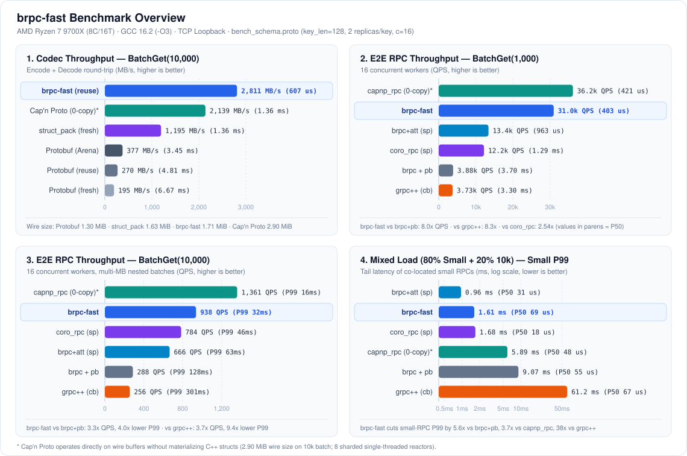

# `brpc-fast`

`brpc-fast` (`brpc_fast`) is a high-performance C++20 serialization codec, Proto3 code generator, and RPC runtime built on top of Apache bRPC (`baidu_std` protocol). It compiles standard `.proto` (Proto3) schemas into plain C++20 structs and typed bRPC services/stubs—bypassing `protoc --cpp_out` and `libprotobuf`'s runtime object model and wire codec—while preserving bRPC's transport, scheduling, routing, and observability.

## Why `brpc-fast`?

Control-plane and metadata services often run demanding mixed workloads: **multi-megabyte metadata batches** containing tens of thousands of nested descriptors alongside **latency-sensitive small RPCs** (such as heartbeats and single-key lookups).

1. **Why Apache bRPC as the RPC layer?**
   Apache bRPC provides a battle-tested M:N `bthread` scheduler, connection pooling, load balancing, timeouts/retries, cooperative cancellation, built-in monitoring/status pages, and scatter/gather `butil::IOBuf` networking.

2. **Why not standard bRPC + `libprotobuf` (`protoc --cpp_out`)?**
   - **Allocation & object-model overhead on large batches**: Standard Protobuf C++ messages heap-allocate nested elements individually (`RepeatedPtrField` pointer chasing, destructor walks, or manual arena plumbing) and pay per-field varint encode/decode branching on every integer. At 10k–30k nested items per RPC, serialization and object lifecycle dominate CPU and tail latency.
   - **Allocator & kernel contention on multi-MB payloads**: Repeatedly allocating and freeing multi-megabyte serialization buffers across concurrent bthreads triggers `mmap`, minor page faults, and `munmap` TLB shootdowns, hurting both large-batch throughput and co-located small-RPC p99 latency.
   - **Verbose C++ API & lifecycle pitfalls**: Raw `google::protobuf::Service`, `brpc::Controller`, and `google::protobuf::Closure` boilerplate makes async lifecycles, cancellation, and server/service teardown ordering easy to get wrong and does not integrate naturally with C++20 value types or coroutines.

3. **Why not a schema-less or raw C++ reflection codec?**
   - Production distributed clusters need **IDL-first contracts** (`.proto` as a single source of truth) and **rolling-upgrade schema evolution**—adding/removing fields, skipping unknown fields in O(1), widening scalars, evolving singular ↔ repeated fields, and keeping `map<K, V>` wire-compatible with repeated map entries.

`brpc-fast` bridges this gap: **Proto3 IDL + schema evolution + Apache bRPC transport**, paired with a **zero-copy, pool-backed, fixed-width binary codec and plain C++20 structs**.

## Benchmarks



Measured on an AMD Ryzen 7 9700X (8C/16T, Linux, GCC 16.2.1 `-O3 -DNDEBUG`, TCP loopback, [`bench_schema.proto`](benchmarks/bench_schema.proto) with `key_len=128`, `replicas_per_key=2`, `concurrency=16`). See [`benchmarks/README.md`](benchmarks/README.md) for the complete codec and E2E tables, small-RPC baselines, versions, and methodology.

| Workload | `brpc-fast` | `brpc + pb` | `grpc++` (Callback) | `coro_rpc` (`struct_pack`) | `capnp_rpc` (0-copy)* |
| :--- | ---: | ---: | ---: | ---: | ---: |
| **Codec `BatchGet(10,000)`** (reuse RT) | **607 us** (1.71 MiB) | 4.81 ms (1.30 MiB) / 3.45 ms Arena | — | 1.36 ms (1.63 MiB) | 1.36 ms (2.90 MiB) |
| **Codec `BatchPutStart(10,000)`** (reuse RT) | **53.7 us** (24.5 GB/s) | 275 us (4.6 GB/s) | — | 171 us (7.7 GB/s) | 96.5 us (15.8 GB/s) |
| **RPC `Ping(c=16)`** QPS / P50 / P99 | 552k / 28.6 us / 38.6 us | 553k / 28.4 us / 38.5 us | 480k / 28.4 us / 106 us | **1,692k / 9.2 us / 10.2 us** | 1,348k / 11.0 us / 29.9 us |
| **RPC `BatchGet(1,000)`** QPS / P50 / P99 | **31.0k / 403 us / 2.07 ms** | 3.88k / 3.70 ms / 9.96 ms | 3.73k / 3.30 ms / 17.9 ms | 12.2k / 1.29 ms / 2.97 ms | 36.2k / 421 us / 880 us |
| **RPC `BatchGet(10,000)`** QPS / P50 / P99 | **938 / 15.5 ms / 32.1 ms** | 288 / 51.3 ms / 128 ms | 256 / 44.7 ms / 301 ms | 784 / 20.2 ms / 45.6 ms | 1,361 / 11.5 ms / 16.3 ms |
| **RPC `Mixed(80%sm+10k)`** small P99 / large QPS | **1.61 ms** / **932** | 9.07 ms / 284 | 61.2 ms / 232 | 1.68 ms / 794 | 5.89 ms / 1,622 |

- **vs. `brpc + protobuf` & native `grpc++`**: **7.9×–11×** faster large-batch codec (**5.7×** vs. Protobuf Arena), **3.3×–8.3×** higher batch RPC throughput, and **5.6× / 38×** lower small-RPC P99 tail latency under mixed large-batch pressure, with zero overhead on tiny `Ping` RPCs (~31% larger wire size on nested payloads: `1.71 MiB` vs. `1.30 MiB`).
- **vs. `coro_rpc` (`struct_pack`)**: `coro_rpc` leads on tiny RPCs (`Ping`/`GetReplica`, ~3.1× QPS) thanks to C++20 stackless coroutines and minimal framing; `brpc-fast` surpasses `coro_rpc` on medium/large batches (**2.54×** QPS on `BatchGet(1,000)`, **+20%** QPS and **30% lower P99** on `BatchGet(10,000)`) and mixed traffic while providing Proto3 schema evolution and bRPC's industrial transport stack.
- **\*vs. `capnp_rpc`**: Cap'n Proto writes/reads wire segments in-place without materializing C++ structs (and ran across 8 manually sharded single-threaded reactors), yielding higher raw large-batch loopback QPS at the cost of **1.70×** larger wire size (`2.90 MiB`), **3.7× worse** small-RPC P99 in mixed traffic (`5.89 ms` vs. `1.61 ms`), and non-value `Builder`/`Reader` APIs.

## Architecture & Key Optimizations

### 1. Tagged Fixed-Width Wire Format with Extensible `SeqKind` Containers
- Uses a compact 3-bit wire type tag (`kFixed1`, `kSigned4`, `kUnsigned4`, `kInt8`, `kFloat4`, `kFloat8`, `kBytes`, `kSeq`) supporting Protobuf field numbers up to `2^29 - 1` (1-byte tags for fields 1–15, 2-byte tags for 16–2047).
- Separates signed 32-bit (`kSigned4`), unsigned 32-bit (`kUnsigned4`), 64-bit integer (`kInt8`), and IEEE-754 floating-point (`kFloat4`, `kFloat8`) wire types—giving exact Proto3 sign/zero-extension semantics across 32↔64-bit integer evolution (`int32(-1) → uint64` sign-extends to `UINT64_MAX`, `uint32(0xFFFFFFFF) → int64` zero-extends to `+4294967295`) and strictly isolating `float`/`double` from integers.
- Encodes all `repeated` and `map` fields under `kSeq` (`uint8 SeqKind`, `varint32 body_len`, payload), enabling O(1) unknown-field / unknown-subtype skipping, bulk `memcpy` for packed scalars, bit-packed `repeated bool` (`kBitBool`, 8× smaller), constant-array compression (`kConst*`), and automatic Structure-of-Arrays columnar encoding (`kColumnar`) with zero-column omission and narrow-integer packing for flat scalar-only repeated messages.
- Supports Proto3 schema evolution (`detail/schema_compat.h`): forward/backward unknown-field skipping, opt-in unknown-field pass-through (`PRESERVE_UNKNOWN_FIELDS`), cross-width scalar conversion, singular ↔ repeated merging (including columnar → singular), and `map<K, V>` ↔ repeated `MapEntry` compatibility.

### 2. Two-Pass Size-Tape + Zero-Copy Slab Encoding
- **Pass 1 (`ComputeSize`)** computes exact byte lengths into a pooled pre-order `SizeTape` (`butil::ObjectPool`).
- **Pass 2 (`EncodeUnchecked`)** writes straight into a contiguous buffer with zero bounds checks.
- Payloads `<= 4 KiB` encode on the stack; larger payloads acquire a pre-warmed buffer from `WriteSlabPool` (size classes from 16 KiB to 8 MiB) and attach it zero-copy to `butil::IOBuf` via `append_user_data`, eliminating per-RPC `mmap`/page-fault/`munmap` overhead.

### 3. Zero-Linearization `IOBuf` Decoding & Capacity Reuse
- `FastReader` decodes directly across multi-block `butil::IOBuf` chains without linearizing multi-MB messages into a flat temporary buffer.
- Contiguous spans run a speculative in-order tag-matching fast path (`MatchConstTag`), falling back cleanly to a full tag-switch loop for out-of-order, unknown, or schema-evolved fields.
- `DecodeFromIOBuf` overwrites destination structs in place to reuse existing `std::vector` and `std::string` capacities. On the server side, `DispatchServerMethod` pools `ServerCallSlot<Req, Resp>` objects via `butil::ObjectPool` (with outlier capacity caps to keep RSS bounded).

### 4. Lightweight Codegen & bRPC Integration
- `brpc_fast_codegen` reads the `FileDescriptorSet` produced by `protoc --descriptor_set_out` and only links `libprotobuf` (no `libprotoc-dev` required).
- Emits plain C++20 structs under `::brpc_fast_pb::<package>` using `std::string`, `std::vector`, `std::optional` (`IndirectOptional` for cyclic message graphs), `std::variant` + typed accessors for `oneof`, and `std::unordered_map` for `map`. Referenced `google/protobuf/*` well-known types are generated automatically without colliding with `libprotobuf`'s `::google::protobuf::*` types.
- Registers lightweight synthetic `MethodDescriptor`s so bRPC's `baidu_std` protocol carries real `service_name` / `method_name` metadata and routes requests through `FastMasterService` (`brpc::BaiduMasterService`) without `protoc --cpp_out`.

### 5. Modern C++20 RPC API
- `FastServer` enforces `AddService -> Start -> Stop/Join -> Service destruction` ordering via RAII.
- `RpcStatus`, `RpcResult<T>`, `CallOptions`, and `RpcContext` provide a minimal, type-safe wrapper over `brpc::Controller`.
- Generated stubs expose both synchronous (`stub.Method(req, resp, opts)`) and asynchronous (`stub.MethodAsync(req, opts)`) calls. `RpcFuture<Resp>` is move-only, supports both bthread-friendly `.Get()` and C++20 `co_await`, cancels safely if dropped unawaited, and supports cooperative cancellation (single-threaded `Cancel()`, or cross-thread `brpc::StartCancel(saved_call_id)` using a `call_id()` saved before `co_await`).

## Directory Layout

| Path | Description |
| :--- | :--- |
| [`codegen/main.cpp`](codegen/main.cpp) | Standalone Proto3-to-C++20 code generator (`brpc_fast_codegen`). |
| [`cmake/BrpcFastGenerate.cmake`](cmake/BrpcFastGenerate.cmake) | `brpc_fast_generate(...)` CMake helper function. |
| [`cmake/FindBRPC.cmake`](cmake/FindBRPC.cmake) | Fetches and configures Apache bRPC 1.18.0 (without leveldb) if `brpc::brpc` is not already provided. |
| [`patches/brpc-without-leveldb.patch`](patches/brpc-without-leveldb.patch) | Minimal patch for bRPC 1.18.0 (optional leveldb, C++20/glibc compatibility, GCC TLS workaround). |
| [`include/brpc_fast/codec.h`](include/brpc_fast/codec.h) | Public `EncodeToIOBuf` / `DecodeFromIOBuf` entry points and `FastMessage` concept. |
| [`include/brpc_fast/service.h`](include/brpc_fast/service.h) | `FastServer`, `FastMasterService`, `RpcStatus`, `RpcResult`, `RpcContext`, `RpcFuture`. |
| [`include/brpc_fast/indirect.h`](include/brpc_fast/indirect.h) | `IndirectOptional` and `IndirectBox` for cyclic message definitions. |
| [`include/brpc_fast/detail/`](include/brpc_fast/detail/) | Wire reader, field codec, schema-evolution converters, buffer/slab pools, and RPC runtime. |
| [`src/service.cpp`](src/service.cpp) | `FastMasterService`, `FastServer`, and synthetic descriptor registration. |
| [`tests/`](tests/) | Unit tests covering codec round-trips, schema evolution, unknown fields, and sync/async/`co_await` RPCs. |
| [`benchmarks/`](benchmarks/) | Core codec and end-to-end loopback RPC benchmarks (see [`benchmarks/README.md`](benchmarks/README.md)). |

## Prerequisites

- C++20 compiler (GCC 11+ or Clang 14+)
- CMake 3.16+ and Ninja / Make
- `protoc` + `libprotobuf-dev` (Protobuf 3.12+ supported; `libprotoc-dev` is not needed)
- `libgflags-dev`, `libglog-dev`, `libssl-dev`, `zlib1g-dev` (required by Apache bRPC; `libleveldb-dev` is not required)

## Usage

### 1. Integrate via CMake `FetchContent`

```cmake
include(FetchContent)
FetchContent_Declare(
  brpc_fast
  GIT_REPOSITORY https://github.com/Aionw/brpc-fast.git
  GIT_TAG main)
FetchContent_MakeAvailable(brpc_fast)

brpc_fast_generate(
  OUT_HDRS MY_FAST_HDRS
  OUT_SRCS MY_FAST_SRCS
  OUT_DIR "${CMAKE_CURRENT_BINARY_DIR}/generated"
  PROTO_ROOT "${CMAKE_CURRENT_SOURCE_DIR}/proto"
  PROTO_FILES my_service.proto
  # Optional: preserve unknown fields across decode -> encode round-trips
  # PRESERVE_UNKNOWN_FIELDS
)

add_library(my_service_proto STATIC ${MY_FAST_SRCS} ${MY_FAST_HDRS})
target_include_directories(my_service_proto PUBLIC "${CMAKE_CURRENT_BINARY_DIR}/generated")
target_link_libraries(my_service_proto PUBLIC brpc_fast::brpc_fast)
```

This generates `my_service.fast.h` and `my_service.fast.cc` containing structs, service base classes, and `<Service>_Stub` classes under `::brpc_fast_pb::<proto_package>`.

### 2. Implement a Server and Call It from a Client

```cpp
#include <brpc/channel.h>
#include "my_service.fast.h"

using namespace brpc_fast;
using namespace ::brpc_fast_pb::my_pkg;

class MyServiceImpl final : public MyService {
 public:
  RpcStatus Ping(const RpcContext& ctx, const PingRequest& req,
                 PingResponse& resp) override {
    resp.ok = true;
    return RpcStatus::Ok();
  }
};

// Server
FastServer server;
server.AddService(std::make_unique<MyServiceImpl>());
server.Start("127.0.0.1:8000");

// Client
brpc::Channel channel;
brpc::ChannelOptions ch_opts;
ch_opts.protocol = brpc::PROTOCOL_BAIDU_STD;
channel.Init("127.0.0.1:8000", &ch_opts);

MyService_Stub stub(&channel);

// Synchronous call (reuses `resp` buffer capacities across calls)
PingResponse resp;
RpcStatus st = stub.Ping({.client_hi = 1, .client_lo = 2}, resp);

// Asynchronous call with blocking `.Get()` or C++20 `co_await`
RpcFuture<PingResponse> fut = stub.PingAsync({.client_hi = 1, .client_lo = 2});
RpcResult<PingResponse> res = fut.Get();
// Or inside a coroutine:
// RpcResult<PingResponse> res = co_await stub.PingAsync({.client_hi = 1, .client_lo = 2});
```

## Build, Test & Benchmark

```bash
# Configure with unit tests and benchmark enabled
cmake -B build -G Ninja -DBRPC_FAST_BUILD_TESTS=ON -DBRPC_FAST_BUILD_BENCHMARK=ON -DCMAKE_BUILD_TYPE=Release

# Build and run unit tests
cmake --build build --target brpc_fast_codec_test brpc_fast_rpc_test -j$(nproc)
ctest --test-dir build --output-on-failure

# Build and run performance benchmark
cmake --build build --target brpc_fast_codec_benchmark -j$(nproc)
./build/brpc_fast_codec_benchmark
```

See [`benchmarks/README.md`](benchmarks/README.md) for benchmark flags and CSV export options.

## Scope & Caveats

- **Wire compatibility**: `brpc-fast` uses its own tagged binary wire format over bRPC's `baidu_std` protocol. It is **not** wire-compatible with standard Protobuf wire encoding; both client and server must use `brpc-fast`.
- **Proto3 unary RPCs only**: `brpc_fast_codegen` enforces `syntax = "proto3"` (proto2 files are rejected) and unary RPC methods (`stream` methods are rejected at codegen time).
- **Server options**: `FastServer` owns the `baidu_master_service` dispatch hook and rejects caller-supplied `options.baidu_master_service` and `options.interceptor` (bRPC's `baidu_master_service` path bypasses `Server::AcceptRequest()`).
- **Limits**: Matches Protobuf's 2 GiB − 1 (`INT32_MAX`) maximum encoded message size, enforces a default max nesting depth of 64, and caps compressed/columnar container expansion at 256 MiB per sequence to prevent DoS from crafted tiny packets.
- **Schema-evolution notes**: `kSigned4`/`kUnsigned4`/`kInt8` preserve exact Proto3 signedness across 32↔64-bit conversions, and `kFloat4`/`kFloat8` are strictly isolated from integer wire types. Because `sint32`/`sfixed32` share `kSigned4`, `fixed32` shares `kUnsigned4`, and `sint64`/`fixed64`/`sfixed64` share `kInt8`, changing between fixed/zigzag/regular integers of the same width is accepted by `brpc-fast` (more permissive than standard Protobuf); `string` fields are also not UTF-8 validated on decode.
- **Coroutine lifetime & cancellation contract**: Once a coroutine suspends on `co_await RpcFuture`, destroying the suspended coroutine frame before resumption is undefined behavior (guarded by a debug assert). `RpcFuture::Cancel()` is not thread-safe; to cancel an in-flight `co_await` from another thread, save `call_id()` before `co_await`, call `brpc::StartCancel(saved_call_id)`, and let the coroutine resume with an error result.

## License

Apache License 2.0. See [`LICENSE`](LICENSE).
