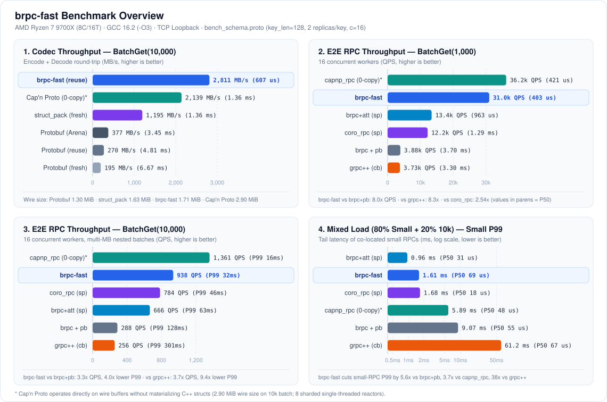
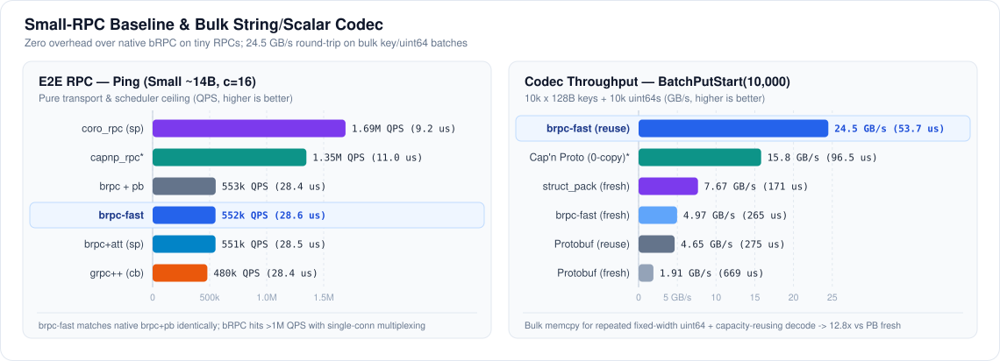

# `brpc-fast` Core Performance Benchmark

Lightweight regression benchmark covering `brpc-fast`'s core codec and end-to-end loopback RPC workloads:

- **Codec**: `Ping(small)`, `BatchGet(<batch_size>)`, and `BatchPutStart(<batch_size>)` (both `fresh` and `reuse` decode modes).
- **End-to-End RPC**: concurrent `BatchGet(<batch_size>)` and mixed `80% small + 20% BatchGet(<batch_size>)` (reporting overall, small-request, and large-batch latencies separately).

## Build & Run

```bash
cmake -B build -G Ninja -DBRPC_FAST_BUILD_BENCHMARK=ON -DCMAKE_BUILD_TYPE=Release
cmake --build build --target brpc_fast_codec_benchmark -j$(nproc)

# Default run (~4s): codec + E2E RPC with batch_size=10000
./build/brpc_fast_codec_benchmark

# Test other batch sizes or export CSV for before/after comparison
./build/brpc_fast_codec_benchmark \
  --batch_size=30000 --csv_path=results.csv --label=after
```

## Flags

| Flag | Default | Description |
| :--- | :--- | :--- |
| `--mode` | `all` | `all`, `codec`, or `rpc` |
| `--batch_size` | `10000` | Batch size for large batch scenarios |
| `--key_len` | `128` | Object key length in bytes |
| `--replicas_per_key` | `2` | Replica descriptors per key |
| `--concurrency` | `16` | Concurrent client bthreads for RPC benchmarks |
| `--warmup_ms` | `200` | Warmup duration before RPC measurement |
| `--duration_ms` | `1500` | Measurement duration per RPC scenario |
| `--csv_path` | `""` | Optional CSV output path |
| `--label` | `run` | Label column written to CSV output |

## Reference Benchmark Results

Head-to-head comparison against standard Apache bRPC + `libprotobuf`, native `grpc++`, `brpc` + `IOBuf` attachment (`struct_pack`), `yalantinglibs` `coro_rpc` (`struct_pack`), and Cap'n Proto (`capnp_rpc`) on the exact same [`bench_schema.proto`](bench_schema.proto) workload (`key_len=128`, `replicas_per_key=2`).





### Environment & Methodology

- **Hardware / Compiler**: AMD Ryzen 7 9700X (8C / 16T, single socket), Linux, GCC 16.2.1 (`-O3 -DNDEBUG -std=c++20 -fcoroutines -fno-tree-slp-vectorize`)
- **Versions & Transport**:
  - `brpc-fast`: Apache bRPC 1.18.0 (`baidu_std`, `connection_type=pooled`), `brpc-fast` codec + `FastMasterService`
  - `brpc+pb`: Apache bRPC 1.18.0 (`baidu_std`, `connection_type=pooled`), `protoc --cpp_out` (`libprotobuf` 7.36.1)
  - `brpc+att(sp)`: Apache bRPC 1.18.0 (`baidu_std`, `connection_type=pooled`), empty PB body + `struct_pack` payload in `IOBuf` attachment
  - `brpc(h2:grpc)`: Apache bRPC 1.18.0 (`h2:grpc`, 16 `single` multiplexed channels), `libprotobuf` 7.36.1
  - `grpc++(cb)`: Native gRPC C++ 1.84.0 (Callback Async Server & Client API, 16 channels with `GRPC_ARG_USE_LOCAL_SUBCHANNEL_POOL=1`, 128 MiB message limit)
  - `coro_rpc`: `yalantinglibs` (`coro_rpc` + `struct_pack`, TCP loopback, 16 server IO threads, 1 client per concurrent worker)
  - `capnp_rpc`: Cap'n Proto 1.5.0 (zero-copy `Builder`/`Reader` without materializing C++ structs; 8 sharded single-threaded KJ reactors + 8 client reactor threads)
- **Measurement**: Loopback TCP (`127.0.0.1`), 300 ms warmup + 2000 ms steady-state measurement per E2E scenario, 0 errors across all reported rows.

### 1. Pure Codec (Encode + Decode)

> `capnp (*, 0cp)` measures building into `MallocMessageBuilder` + `messageToFlatArray` (encode) and traversing every field via `FlatArrayMessageReader` without copying into C++ structs (decode).

| Scenario | Codec | Wire Size | Enc (p50) | Dec (p50) | RT (avg) | Throughput (MB/s) |
| :--- | :--- | ---: | ---: | ---: | ---: | ---: |
| **Ping(small)** | `struct_pack (reuse)` | 20 B | 20.0 ns | 20.0 ns | **33.3 ns** | 572.9 |
| | `brpc-fast (reuse)` | 14 B | 30.0 ns | 20.0 ns | **44.2 ns** | 302.1 |
| | `protobuf (reuse)` | 7 B | 40.0 ns | 30.0 ns | 73.9 ns | 90.3 |
| | `protobuf (arena)` | 7 B | 40.0 ns | 60.0 ns | 102.1 ns | 65.4 |
| | `capnp (reuse, 0cp)` | 32 B | 50.0 ns | 40.0 ns | 84.4 ns | 361.5 |
| **GetReplica(1)** | `brpc-fast (fresh)` | 171 B | 50.0 ns | 140.0 ns | 195.3 ns | 835.2 |
| | **`brpc-fast (reuse)`** | 171 B | 50.0 ns | 50.0 ns | **105.1 ns** | **1,551.7** |
| | `struct_pack (fresh)` | 165 B | 30.0 ns | 80.0 ns | 108.1 ns | 1,456.1 |
| | `capnp (reuse, 0cp)` | 320 B | 90.0 ns | 130.0 ns | 221.1 ns | 1,380.1 |
| | `protobuf (reuse)` | 132 B | 120.0 ns | 260.0 ns | 386.9 ns | 325.3 |
| | `protobuf (arena)` | 132 B | 110.0 ns | 280.0 ns | 400.7 ns | 314.1 |
| **BatchGet(1000)** | `brpc-fast (fresh)` | 174.8 KiB | 25.23 us | 172.01 us | 197.57 us | 864.0 |
| *(2k nested replicas)* | **`brpc-fast (reuse)`** | 174.8 KiB | **24.55 us** | **36.26 us** | **61.10 us** | **2,793.6** |
| | `struct_pack (fresh)` | 167.0 KiB | 35.46 us | 72.32 us | 107.74 us | 1,513.7 |
| | `capnp (reuse, 0cp)` | 297.0 KiB | 44.64 us | 83.77 us | 128.62 us | 2,254.7 |
| | `protobuf (arena)` | 132.7 KiB | 73.87 us | 249.62 us | 323.22 us | 400.9 |
| | `protobuf (reuse)` | 132.7 KiB | 73.93 us | 397.57 us | 471.86 us | 274.6 |
| | `protobuf (fresh)` | 132.7 KiB | 74.59 us | 559.08 us | 634.16 us | 204.3 |
| **BatchGet(10000)** | `brpc-fast (fresh)` | 1.71 MiB | 263.39 us | 1.89 ms | 2.16 ms | 790.0 |
| *(20k nested replicas)* | **`brpc-fast (reuse)`** | 1.71 MiB | **247.58 us** | **358.32 us** | **607.25 us** | **2,811.1** |
| | `capnp (reuse, 0cp)` | 2.90 MiB | 503.48 us | 844.29 us | 1.36 ms | 2,139.2 |
| | `struct_pack (fresh)` | 1.63 MiB | 502.82 us | 861.68 us | 1.36 ms | 1,194.9 |
| | `protobuf (arena)` | 1.30 MiB | 745.80 us | 2.72 ms | 3.45 ms | 376.8 |
| | `protobuf (reuse)` | 1.30 MiB | 753.30 us | 4.06 ms | 4.81 ms | 270.2 |
| | `protobuf (fresh)` | 1.30 MiB | 762.91 us | 5.85 ms | 6.67 ms | 195.1 |
| **BatchPutStart(10000)** | `brpc-fast (fresh)` | 1.32 MiB | 26.91 us | 237.30 us | 264.98 us | 4,966.9 |
| *(10k keys + uint64s)* | **`brpc-fast (reuse)`** | 1.32 MiB | **26.84 us** | **26.70 us** | **53.72 us** | **24,499.7** |
| | `capnp (reuse, 0cp)` | 1.53 MiB | 53.85 us | 42.38 us | 96.48 us | 15,817.4 |
| | `struct_pack (fresh)` | 1.32 MiB | 27.00 us | 144.15 us | 171.49 us | 7,674.7 |
| | `protobuf (reuse)` | 1.28 MiB | 118.63 us | 155.45 us | 274.66 us | 4,646.4 |
| | `protobuf (fresh)` | 1.28 MiB | 117.07 us | 551.48 us | 669.11 us | 1,907.3 |

### 2. End-to-End Loopback RPC

| Scenario | Implementation | Class | QPS | MB/s | Avg | P50 | P99 | P999 |
| :--- | :--- | :--- | ---: | ---: | ---: | ---: | ---: | ---: |
| **Ping (c=16)** | `coro_rpc` | rpc | **1,691,734** | 64.5 | **9.42 us** | **9.23 us** | **10.16 us** | **17.69 us** |
| | `capnp_rpc` | rpc | 1,348,081 | 82.3 | 11.83 us | 11.01 us | 29.88 us | 100.73 us |
| | `brpc+pb` | rpc | 553,118 | 4.2 | 28.83 us | 28.44 us | 38.48 us | 59.05 us |
| | **`brpc-fast`** | rpc | **551,665** | 16.8 | 28.97 us | 28.60 us | 38.56 us | 49.71 us |
| | `brpc+att(sp)` | rpc | 551,287 | 21.0 | 28.92 us | 28.54 us | 38.27 us | 54.75 us |
| | `brpc(h2:grpc)` | rpc | 514,315 | 3.9 | 30.88 us | 30.46 us | 40.73 us | 58.71 us |
| | `grpc++(cb)` | rpc | 480,184 | 3.7 | 33.17 us | 28.35 us | 105.57 us | 253.40 us |
| **Ping (c=64)** | `coro_rpc` | rpc | **1,460,647** | 55.7 | **43.78 us** | **35.32 us** | **96.59 us** | 1.74 ms |
| | `capnp_rpc` | rpc | 1,433,102 | 87.5 | 44.62 us | 43.68 us | 97.57 us | 226.47 us |
| | `brpc(h2:grpc)` *(16×`single`)* | rpc | 1,015,814 | 7.8 | 62.45 us | 61.06 us | 108.49 us | 210.01 us |
| | `grpc++(cb)` | rpc | 500,993 | 3.8 | 127.59 us | 95.67 us | 594.66 us | 1.03 ms |
| | `brpc-fast` *(`pooled`)* | rpc | 481,447 | 14.7 | 132.90 us | 133.23 us | 159.67 us | 232.84 us |
| | `brpc+pb` *(`pooled`)* | rpc | 478,328 | 3.6 | 133.67 us | 133.23 us | 151.56 us | **185.35 us** |
| **GetReplica (c=16)** | `coro_rpc` | rpc | **1,547,557** | 461.9 | **10.30 us** | **9.73 us** | **10.75 us** | **21.06 us** |
| | `capnp_rpc` | rpc | 1,318,456 | 633.7 | 12.10 us | 10.89 us | 31.52 us | 106.31 us |
| | `brpc+att(sp)` | rpc | 514,480 | 153.6 | 30.98 us | 30.60 us | 40.62 us | 50.42 us |
| | `brpc(h2:grpc)` | rpc | 486,347 | 129.4 | 32.63 us | 32.37 us | 41.02 us | 49.21 us |
| | **`brpc-fast`** | rpc | **469,181** | 142.3 | 34.07 us | 33.59 us | 44.40 us | 61.09 us |
| | `brpc+pb` | rpc | 459,099 | 122.2 | 34.71 us | 34.27 us | 44.58 us | 65.60 us |
| | `grpc++(cb)` | rpc | 405,814 | 108.0 | 39.29 us | 31.07 us | 165.91 us | 435.86 us |
| **BatchGet(1000, c=16)** | `capnp_rpc` *(0-copy)* | batch | **36,172** | 15,736 | 442.24 us | 421.12 us | **880.17 us** | **1.34 ms** |
| | **`brpc-fast`** | batch | **30,988** | **9,132** | 516.21 us | **402.95 us** | 2.07 ms | 3.07 ms |
| | `brpc+att(sp)` | batch | 13,421 | 3,853 | 1.18 ms | 963.46 us | 3.53 ms | 4.68 ms |
| | `coro_rpc` | batch | 12,188 | 3,499 | 1.31 ms | 1.29 ms | 2.97 ms | 3.68 ms |
| | `brpc(h2:grpc)` | batch | 4,205 | 1,070 | 3.79 ms | 3.50 ms | 9.16 ms | 11.21 ms |
| | `brpc+pb` | batch | 3,875 | 986 | 4.11 ms | 3.70 ms | 9.96 ms | 13.28 ms |
| | `grpc++(cb)` | batch | 3,735 | 951 | 4.28 ms | 3.30 ms | 17.88 ms | 44.00 ms |
| **BatchGet(10000, c=16)** | `capnp_rpc` *(0-copy, 2.90 MiB)* | batch | **1,361.0** | 5,919 | **11.75 ms** | **11.50 ms** | **16.32 ms** | **18.71 ms** |
| | **`brpc-fast`** *(1.71 MiB)* | batch | **937.5** | **2,763** | 17.07 ms | 15.46 ms | 32.13 ms | 36.97 ms |
| | `coro_rpc` *(1.63 MiB)* | batch | 784.4 | 2,252 | 20.32 ms | 20.20 ms | 45.64 ms | 58.23 ms |
| | `brpc+att(sp)` *(1.63 MiB)* | batch | 666.0 | 1,912 | 23.74 ms | 19.56 ms | 63.00 ms | 82.38 ms |
| | `brpc+pb` *(1.30 MiB)* | batch | 288.0 | 734 | 55.48 ms | 51.29 ms | 127.77 ms | 147.05 ms |
| | `grpc++(cb)` *(1.30 MiB)* | batch | 256.4 | 654 | 59.74 ms | 44.74 ms | 300.72 ms | 432.10 ms |
| **Mixed (80%sm + 10k, c=16)** | **`brpc-fast`** | small / large | 3,760 / 932 | 2,746 | 183 us / 16.4 ms | 69 us / 15.2 ms | **1.61 ms** / 29.9 ms | 2.78 ms / 34.3 ms |
| | `coro_rpc` | small / large | 3,231 / 794 | 2,279 | 85 us / 19.7 ms | **18 us** / 18.5 ms | 1.68 ms / 45.2 ms | 2.51 ms / 54.3 ms |
| | `capnp_rpc` | small / large | 6,636 / 1,622 | 7,058 | 1.01 ms / 5.74 ms | 48 us / 5.46 ms | 5.89 ms / 9.51 ms | 6.89 ms / 10.8 ms |
| | `brpc+att(sp)` | small / large | 2,694 / 661 | 1,898 | 84 us / 23.6 ms | 31 us / 19.5 ms | **958 us** / 63.7 ms | 2.17 ms / 75.3 ms |
| | `brpc+pb` | small / large | 1,130 / 284 | 723 | 854 us / 52.6 ms | 55 us / 48.6 ms | 9.07 ms / 129.3 ms | 13.0 ms / 148.7 ms |
| | `grpc++(cb)` | small / large | 960 / 232 | 590 | 3.16 ms / 55.5 ms | 67 us / 48.5 ms | 61.15 ms / 144.2 ms | 80.5 ms / 163.6 ms |

### Key Takeaways

- **Batch acceleration over Protobuf / gRPC**: On `BatchGet(1000)` and `BatchGet(10000)`, `brpc-fast` delivers **8.0× / 3.3×** higher QPS than `brpc+pb` and **8.3× / 3.7×** higher QPS than native `grpc++(cb)`, while cutting mixed-workload small-RPC P99 from `9.07 ms` (`brpc+pb`) and `61.15 ms` (`grpc++`) down to **`1.61 ms`**.
- **Outperforming `coro_rpc` on medium/large batches**: `coro_rpc` leads on tiny single-key RPCs (`Ping` / `GetReplica`, ~3.1× QPS) due to C++20 stackless coroutines and lightweight framing, whereas `brpc-fast` surpasses `coro_rpc` on `BatchGet(1000)` (**2.54×** QPS), `BatchGet(10000)` (**+20%** QPS, **30%** lower P99), and mixed traffic thanks to pooled `ServerCallSlot` capacity reuse, zero-copy `WriteSlabPool` encoding, and zero-linearization `IOBuf` decoding.
- **Trade-offs vs. `capnp_rpc`**: Cap'n Proto's in-place `Builder`/`Reader` model avoids materializing C++ structs on both ends and leads raw large-batch loopback QPS, but incurs **1.70×** larger wire size (`2.90 MiB` vs. `1.71 MiB`), **3.7×** higher small-RPC P99 under mixed load (`5.89 ms` vs. `1.61 ms`) due to non-preemptive single-reactor event loops, and requires manual multi-port sharding and non-owning handles.
- **Connection multiplexing tip**: In `Ping(c=64)`, `brpc(h2:grpc)` using 16 `single` multiplexed channels reached **1.02M QPS** (P50 `61 us`, P999 `210 us`), compared to ~480k QPS with `connection_type=pooled`. For high-concurrency small control-plane RPCs on bRPC, prefer `single` connection multiplexing (with a small number of `connection_group`s) over `pooled`.
